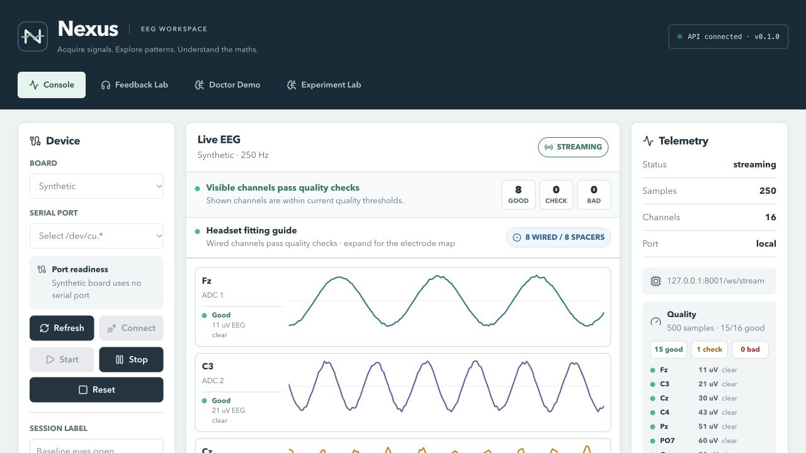
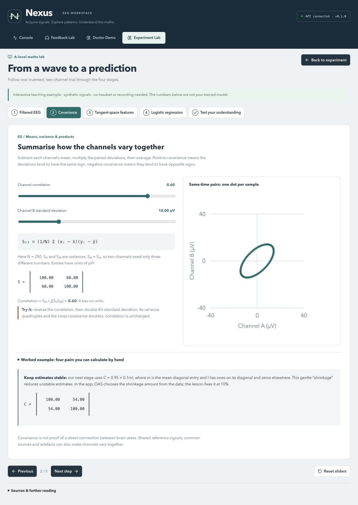
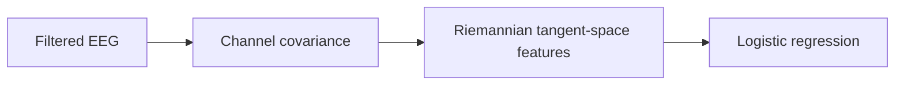

<div align="center">


# Nexus BCI

### Your EEG science project starts here.

Record signals. Label experiments. Test a classifier. Understand the maths.

[Start here](#start-here) · [First experiment (PDF)](docs/eyes-open-closed-experiment-guide.pdf) · [Research guide](docs/student-starter-guide.pdf) · [Experiment Lab](docs/experiment-lab.md) · [Contributing](CONTRIBUTING.md)

</div>



Nexus is a local workspace for exploring EEG with an OpenBCI headset. It brings live waveforms, electrode quality, labelled trials and a small machine-learning classifier into one app, with an interactive maths lesson to explain what happens along the way.

The app’s visible title is **Dr K’s EEG Lab**. Nexus remains the project name, including the **Nexus Server** desktop launcher.

**No headset yet? You can explore the app and learn the maths using its synthetic board. No API key or GPU is required.**

> This is experimental education and research software. Task labels describe instructions, not verified thoughts, focus or relaxation. Synthetic signals are a software rehearsal; they are not evidence of brain-state classification. Nexus provides no clinical interpretation.

## Start here

### 1. Get the essentials

For the recommended setup, use **macOS 13.5 or later**, **Python 3.12+**, **Node 24** and **Git**. Install Python from [python.org](https://www.python.org/downloads/macos/) and Node from [nodejs.org](https://nodejs.org/en/download). Node's [platform requirements](https://github.com/nodejs/node/blob/v24.x/BUILDING.md#platform-list) explain the macOS minimum.

If you use nvm, run `nvm install && nvm use` after cloning. Intel Mac and physical-headset installation still need independent validation; the services are also tested in Linux CI. The desktop launcher is macOS-specific.

**Intel MacBook on Ventura:** use macOS **13.5 or later** (13.7.8 meets this minimum), the standard [Python 3.13 macOS installer](https://www.python.org/downloads/release/python-31316/) and **Node 24 for macOS x64/Intel**. The Python installer supports Intel Macs; use its standard build. These versions have been checked for compatible dependency wheels and native-library targets. Running Nexus and collecting headset data on an Intel Ventura Mac still need an on-device test.

Send your team the [two-page Intel/Ventura setup guide (PDF)](docs/intel-ventura-setup.pdf), or use its [copyable text version](docs/intel-ventura-setup.md). It walks through installation, a first simulated recording and troubleshooting.

If Git prompts for Apple's Command Line Tools, finish that installation first. You can start it with `xcode-select --install`; the full Xcode application is not needed. After installing Python and Node, open a new Terminal and check `python3.13 --version` and `node --version`.

### 2. Install Nexus

```bash
git clone https://github.com/zook111/Nexus_BCI.git nexus
cd nexus
./script/setup.sh
./script/install_desktop_launcher.sh
```

For the Intel/Ventura setup above, replace `./script/setup.sh` with `NEXUS_PYTHON=python3.13 ./script/setup.sh` to select that interpreter explicitly. Use a fresh checkout on each machine; setup creates its local `.venv` and `node_modules`.

Open **Nexus Server** on your Desktop. It starts the local services and opens [localhost:5173](http://localhost:5173). Open it again to stop them. Keep the checkout in place: the launcher points to it.

Reinstallation makes recoverable backups. A legacy Mindmeld launcher is retired only when it belongs to this checkout. Internal `mindmeld_api` imports and `MINDMELD_*` settings remain compatible with earlier installations.

### 3. See your first signal

1. Open **Console**, choose **Synthetic**, and click **Connect**, then **Start**.
2. Watch the waveforms, per-channel quality and frequency-band summary.
3. Enter a session label, click **Record**, then **Capture setup** after a quality window is available, and **Save**. Preview or download the CSV under **Telemetry**.
4. Open **Experiment Lab → How the classifier works**. The lesson works without a headset or any participant recording.
5. Use **Stop** to stop acquisition and **Reset** to release the board.

<details>
<summary><strong>Prefer two development terminals?</strong></summary>

After setup, run these from the repository root:

```bash
# Terminal 1: API at http://127.0.0.1:8000
.venv/bin/python -m uvicorn mindmeld_api.main:app \
  --app-dir backend/src --host 127.0.0.1 --port 8000
```

```bash
# Terminal 2: UI at http://127.0.0.1:5173
npm run dev --prefix frontend -- --host 127.0.0.1 --port 5173
```

API documentation: [127.0.0.1:8000/docs](http://127.0.0.1:8000/docs).

To install manually, create a Python 3.12+ `.venv`, install `pip install -e 'backend[dev]'` inside it, and run `npm ci --prefix frontend`. The setup script performs these steps for you without installing global Python packages.

</details>

## Turn it into a school project

A useful first question is:

> **Can a classifier distinguish eyes-open from eyes-closed trials in a separate recording from the same participant, better than chance?**

Follow the [eyes-open vs eyes-closed experiment guide (PDF)](docs/eyes-open-closed-experiment-guide.pdf) for step-by-step trial collection, labelling, separate training/test recordings and a results worksheet. It is written for a two-student team using Experiment Lab.

Use the [two-page student starter guide](docs/student-starter-guide.pdf) for clickable introductory reading and a first-week plan. Work together on the basics, split the biology/hardware and maths/analysis reading, then teach it back to each other.

| Stage | What to do | What to keep |
| --- | --- | --- |
| **Rehearse** | Practise recording and labelling with synthetic signals. | A checklist of steps and questions. |
| **Plan** | Agree instructions, controls, quality/exclusion rules and participant codes with your teacher. | A one-page method written before collecting data. |
| **Collect** | Record balanced, guided trials in Experiment Lab; review labels and exclusions. | Raw CSV, annotations and notes. |
| **Test** | Train on one recording, then evaluate a separate, untouched recording from the same participant. | Confusion matrix, balanced accuracy, chance benchmark and rejected-trial reasons. |
| **Explain** | Discuss noise, artefacts, sample size and what your result does or does not establish. | A reproducible report, including weak or negative results. |

Start with manageable sessions and breaks. The guide suggests aiming initially for 20 trials per task; minimum accepted trial counts in the software are operating limits, not a guarantee of a strong experiment. Swap operator/participant roles, keeping each participant's training and test data separate and correctly coded.

Read the [Experiment Lab method and limitations](docs/experiment-lab.md) before using participant data. Eyes-open/closed and left/right hand-imagery presets are available, along with two to four custom task labels. Motor imagery is an investigation, not a promised capability.

## Learn what the classifier is doing





The lesson explains frequencies, means, covariance, logarithms, the sigmoid and fair testing through linked sliders and worked examples. Matrix details are optional extension material.

The real classifier uses OAS-shrinkage covariance with pyRiemann and scikit-learn logistic regression. All feature fitting uses training data only. Reports include file hashes, method settings, package versions and per-trial predictions. Probabilities are not calibrated confidence. The current module evaluates saved trials; it does not deploy a persistent classifier for live device control.

## Find your workspace

| Workspace | Purpose |
| --- | --- |
| **Console** | Acquisition, raw traces, quality checks, DSP, recordings, replay and calibration markers. |
| **Experiment Lab** | Guided task cues, balanced labels, trial review, separate training/test data and the maths lesson. |
| **Help** | Bundled setup, eyes-open/closed experiment and first-week research PDFs, available offline. |
| **Feedback Lab** | Optional visual and audio feedback that pauses when signal quality is inadequate. |
| **Doctor Demo** | Eyes-open/closed demonstrations and confidence-gated group experiences. Non-clinical throughout. |

## Connect the headset

Nexus supports **Cyton, 8 channels**, and **Cyton Daisy, 16 channels**, with the OpenBCI USB dongle. Follow the manufacturer's [Cyton guide](https://docs.openbci.com/GettingStarted/Boards/CytonGS/) and hardware/electrical-safety instructions. USB-C laptops may need an adapter.

Select the correct board and recommended serial port, then **Connect → Start**. On macOS, prefer `/dev/cu.*` ports. Hardware connection is manual by default. A generic FTDI or Bluetooth port does not prove that the right board is attached.

Before collecting trials, check advancing timestamps and several consecutive usable quality windows. Secure electrode/reference contacts and review artefacts. Filtering cannot repair a disconnected contact. Mains filtering defaults to **50 Hz**; adjust it in a 60 Hz region before creating an experiment. Experiment Lab stores that setting for live checks, offline rejection and matching training/test sessions.

## Keep your data local

Recordings, labels and reports stay under `recordings/`; demo-room data stays under `data/`. Git ignores both, along with common EEG exports, local credentials and generated model files. Use participant codes and obtain appropriate permission. Do not put participant data in issues or PRs.

Classification does not upload recordings. Optional Cartesia calibration speech sends cue text to that provider; browser speech is available as a fallback. Bundled audio plays locally. All screenshots and lesson examples use synthetic signals.

The API is for trusted local use. It binds to loopback through the launcher and validates browser origins for HTTP and WebSocket requests. Origin checks are not authentication against other local processes. See [security and privacy](SECURITY.md).

<details>
<summary><strong>Optional settings</strong></summary>

Defaults work without an environment file. For backend options, copy `backend/.env.example` to `.env`. Keep credentials out of `VITE_*` settings: those values become public frontend JavaScript.

| Setting | Purpose |
| --- | --- |
| `MINDMELD_FRONTEND_PORT` | Optional launcher UI port; its loopback origins are allowed automatically. |
| `MINDMELD_RECORDING_DIR` | Local recording storage; default `recordings`. |
| `MINDMELD_DEMO_DB_PATH` | Local demo database; default `data/mindmeld_demo.sqlite3`. |
| `CARTESIA_API_KEY` / `MINDMELD_CARTESIA_API_KEY` | Optional hosted calibration speech. Blank uses the fallback. |
| `VITE_API_BASE_URL` | Frontend API URL; default `http://localhost:8000`. |
| `VITE_OPENBCI_AUTOCONNECT_SERIAL` | Optional known dongle serial in `frontend/.env.local`; requires the board setting below. |
| `VITE_OPENBCI_AUTOCONNECT_BOARD` | `cyton` or `cyton_daisy`. Both values are required for auto-connect; missing/invalid board settings keep setup manual. |

</details>

## If something is not working

| Symptom | Try this |
| --- | --- |
| Setup rejects Python or Node | Check versions. Use Node 24 and Python 3.12+. `NEXUS_PYTHON=/path/to/python ./script/setup.sh` selects an interpreter. |
| Port 8000 or 5173 is occupied | Stop the application that owns it. Nexus does not kill unrelated listeners. |
| No suitable USB port | Check the dongle and adapter, then Refresh. Use Synthetic to test the software separately. |
| `BOARD_NOT_READY_ERROR:7` | Check board power/radio mode. Release the port, wait a few seconds, then Reset and reconnect. |
| Frozen samples or a lost session | The live socket retries with bounded backoff; Refresh retries again if needed. For a lost native board, Reset, let the dongle settle, then Connect and Start. |
| Noisy channels | Secure reference/bias and electrode contacts, keep leads away from power supplies, and try the laptop on battery. |
| No spoken cue | Visual instructions remain available. Browser speech support varies; audio requires a user interaction. |

For launcher diagnostics, use `./script/build_and_run.sh --status`, `--verify` or `--logs`. Legacy-compatible logs remain under `~/Library/Application Support/Mindmeld Launcher`.

## Built for learning and inspection

React, TypeScript and Vite provide the interface; Python, FastAPI, BrainFlow and NumPy/SciPy handle acquisition and analysis; pyRiemann and scikit-learn provide classification. Live samples use WebSockets.

See [Contributing](CONTRIBUTING.md) for checks, [project status](project_status.md) for verified behavior and remaining platform tests, and [release verification](docs/public-release.md) for publication checks.

**Licence:** [MIT](LICENSE) for software, documentation and original brand assets. Bundled generated audio has separate [media notices](MEDIA.md). Dependencies retain their upstream licences.
